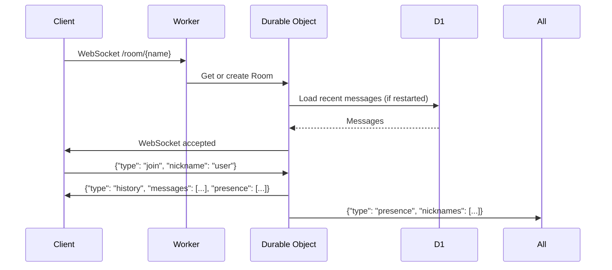
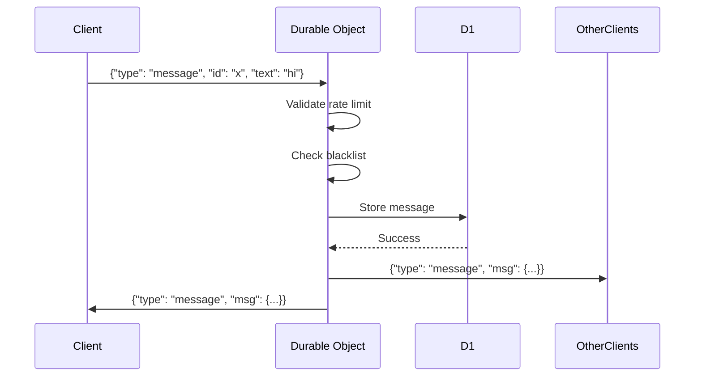
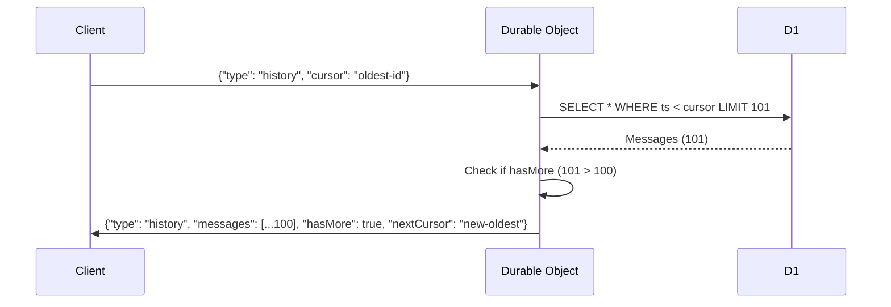
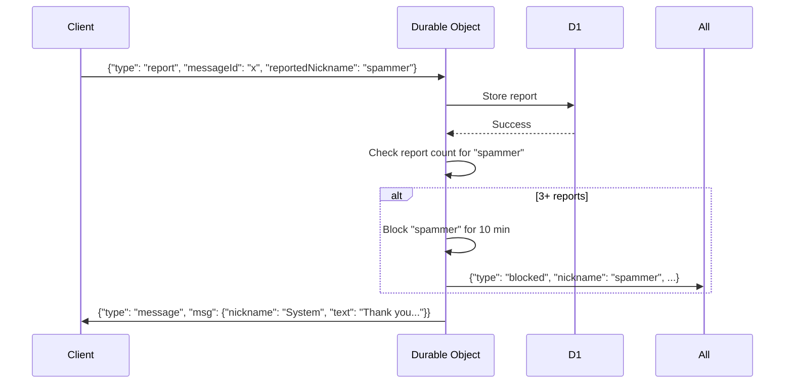

# WebSocket API Protocol

## Base URL

**Production**: `wss://your-worker.workers.dev/room/{roomName}`
**Development**: `ws://localhost:8787/room/{roomName}`

## Connection

Standard WebSocket upgrade from HTTPS:

```http
GET /room/{roomName} HTTP/1.1
Host: your-worker.workers.dev
Upgrade: websocket
Connection: Upgrade
Sec-WebSocket-Key: ...
Sec-WebSocket-Version: 13
```

Response:
```http
HTTP/1.1 101 Switching Protocols
Upgrade: websocket
Connection: Upgrade
Sec-WebSocket-Accept: ...
```

## Message Format

All messages are JSON strings:
```json
{
  "type": "message_type",
  "...": "payload"
}
```

## Client → Server Messages

### 1. Join Room

Sent when a user joins a room.

```json
{
  "type": "join",
  "nickname": "string",
  "lastMessageId": "string?"
}
```

**Fields**:
| Field | Type | Required | Description |
|-------|------|----------|-------------|
| `type` | string | Yes | Always "join" |
| `nickname` | string | Yes | User's nickname (1-50 chars, alphanumeric, underscores, hyphens) |
| `lastMessageId` | string | No | UUID of the last message the user has seen (for reconnection sync) |

**Response**: Server sends `history` event with messages and presence.

**Errors**:
- `INVALID_INPUT` - Invalid nickname format
- `NICKNAME_TAKEN` - Nickname already in use in this room
- `BLOCKED` - User is blocked from this room

**Example**:
```json
{
  "type": "join",
  "nickname": "john_doe",
  "lastMessageId": "550e8400-e29b-41d4-a716-446655440000"
}
```

---

### 2. Send Message

Sent when a user sends a message.

```json
{
  "type": "message",
  "id": "string",
  "text": "string"
}
```

**Fields**:
| Field | Type | Required | Description |
|-------|------|----------|-------------|
| `type` | string | Yes | Always "message" |
| `id` | string | Yes | Message UUID (generated by client) |
| `text` | string | Yes | Message content (1-1000 chars) |

**Response**: Server broadcasts `message` event to all clients in the room.

**Errors**:
- `INVALID_INPUT` - Invalid message format or length
- `RATE_LIMIT` - Too many messages (5 per 10 seconds)
- `BLOCKED` - User is blocked
- `FILTERED` - Message contains blacklisted words

**Example**:
```json
{
  "type": "message",
  "id": "550e8400-e29b-41d4-a716-446655440001",
  "text": "Hello everyone!"
}
```

---

### 3. Typing Indicator

Sent when a user is typing.

```json
{
  "type": "typing"
}
```

**Fields**:
| Field | Type | Required | Description |
|-------|------|----------|-------------|
| `type` | string | Yes | Always "typing" |

**Response**: Server broadcasts `typing` event to other clients in the room.

**Note**: Typing indicators are debounced (300ms) on the client side.

**Example**:
```json
{
  "type": "typing"
}
```

---

### 4. Report Message

Sent when a user reports a message.

```json
{
  "type": "report",
  "messageId": "string",
  "reportedNickname": "string",
  "reason": "string?"
}
```

**Fields**:
| Field | Type | Required | Description |
|-------|------|----------|-------------|
| `type` | string | Yes | Always "report" |
| `messageId` | string | Yes | ID of the reported message |
| `reportedNickname` | string | Yes | Nickname of the reported user |
| `reason` | string | No | Optional reason for the report |

**Response**: Server stores the report and sends acknowledgment to reporter.

**Auto-block**: After 3 reports on the same user, they are automatically blocked for 10 minutes.

**Example**:
```json
{
  "type": "report",
  "messageId": "550e8400-e29b-41d4-a716-446655440001",
  "reportedNickname": "spammer",
  "reason": "Spamming the room"
}
```

---

### 5. Load History

Sent when a user scrolls up to load older messages (infinite scroll).

```json
{
  "type": "history",
  "cursor": "string?"
}
```

**Fields**:
| Field | Type | Required | Description |
|-------|------|----------|-------------|
| `type` | string | Yes | Always "history" |
| `cursor` | string | No | Message ID to load messages older than this. If not provided, loads most recent messages. |

**Response**: Server sends `history` event with older messages and pagination info.

**Example**:
```json
{
  "type": "history",
  "cursor": "550e8400-e29b-41d4-a716-446655440000"
}
```

---

## Server → Client Messages

### 1. History

Sent in response to `join` or `history` request. Contains messages and presence information.

```json
{
  "type": "history",
  "messages": [
    {
      "id": "string",
      "nickname": "string",
      "text": "string",
      "ts": 1234567890
    }
  ],
  "presence": ["string"],
  "hasMore": true,
  "nextCursor": "string?"
}
```

**Fields**:
| Field | Type | Required | Description |
|-------|------|----------|-------------|
| `type` | string | Yes | Always "history" |
| `messages` | Message[] | Yes | Array of messages (max 100 per request) |
| `presence` | string[] | Yes | Array of nicknames currently in the room |
| `hasMore` | boolean | Yes | True if there are more older messages available |
| `nextCursor` | string | No | Message ID to use for the next history request |

**Message Object**:
| Field | Type | Description |
|-------|------|-------------|
| `id` | string | Message UUID |
| `nickname` | string | Sender's nickname |
| `text` | string | Message content |
| `ts` | number | Timestamp in milliseconds |

**Example**:
```json
{
  "type": "history",
  "messages": [
    {
      "id": "550e8400-e29b-41d4-a716-446655440001",
      "nickname": "john_doe",
      "text": "Hello everyone!",
      "ts": 1700000000000
    },
    {
      "id": "550e8400-e29b-41d4-a716-446655440000",
      "nickname": "jane_doe",
      "text": "Hi John!",
      "ts": 1700000000001
    }
  ],
  "presence": ["john_doe", "jane_doe"],
  "hasMore": false,
  "nextCursor": null
}
```

---

### 2. Message

Sent when a new message is received.

```json
{
  "type": "message",
  "msg": {
    "id": "string",
    "nickname": "string",
    "text": "string",
    "ts": 1234567890
  }
}
```

**Fields**:
| Field | Type | Required | Description |
|-------|------|----------|-------------|
| `type` | string | Yes | Always "message" |
| `msg` | Message | Yes | The message object (same structure as in history) |

**Example**:
```json
{
  "type": "message",
  "msg": {
    "id": "550e8400-e29b-41d4-a716-446655440001",
    "nickname": "john_doe",
    "text": "Hello everyone!",
    "ts": 1700000000000
  }
}
```

---

### 3. Presence

Sent when the presence in the room changes (user joins/leaves).

```json
{
  "type": "presence",
  "nicknames": ["string"]
}
```

**Fields**:
| Field | Type | Required | Description |
|-------|------|----------|-------------|
| `type` | string | Yes | Always "presence" |
| `nicknames` | string[] | Yes | Array of nicknames currently in the room |

**Example**:
```json
{
  "type": "presence",
  "nicknames": ["john_doe", "jane_doe", "bob"]
}
```

---

### 4. Typing

Sent when another user is typing.

```json
{
  "type": "typing",
  "nickname": "string"
}
```

**Fields**:
| Field | Type | Required | Description |
|-------|------|----------|-------------|
| `type` | string | Yes | Always "typing" |
| `nickname` | string | Yes | Nickname of the user who is typing |

**Note**: Typing indicators expire after 3 seconds on the client side.

**Example**:
```json
{
  "type": "typing",
  "nickname": "john_doe"
}
```

---

### 5. Blocked

Sent when a user is blocked (server-side).

```json
{
  "type": "blocked",
  "nickname": "string",
  "duration": 600000,
  "reason": "string"
}
```

**Fields**:
| Field | Type | Required | Description |
|-------|------|----------|-------------|
| `type` | string | Yes | Always "blocked" |
| `nickname` | string | Yes | Nickname of the blocked user |
| `duration` | number | Yes | Block duration in milliseconds (default: 600000 = 10 minutes) |
| `reason` | string | Yes | Reason for the block |

**Example**:
```json
{
  "type": "blocked",
  "nickname": "spammer",
  "duration": 600000,
  "reason": "Too many reports"
}
```

---

### 6. Error

Sent when an error occurs.

```json
{
  "type": "error",
  "code": "string"
}
```

**Fields**:
| Field | Type | Required | Description |
|-------|------|----------|-------------|
| `type` | string | Yes | Always "error" |
| `code` | string | Yes | Error code (see below) |

**Error Codes**:
| Code | Description | When It Occurs |
|------|-------------|----------------|
| `RATE_LIMIT` | Too many messages | User sends more than 5 messages in 10 seconds |
| `INVALID_INPUT` | Invalid input | Invalid message/nickname format or length |
| `BLOCKED` | User is blocked | User tries to join or send message while blocked |
| `FILTERED` | Message filtered | Message contains blacklisted words |
| `NICKNAME_TAKEN` | Nickname in use | User tries to join with a taken nickname |
| `INTERNAL_ERROR` | Server error | Unexpected server-side error |

**Example**:
```json
{
  "type": "error",
  "code": "RATE_LIMIT"
}
```

---

## Sequence Diagrams

### Join Flow



### Message Flow



### History Pagination Flow



### Report Flow



---

## Rate Limiting

- **Limit**: 5 messages per 10 seconds per connection
- **Enforcement**: Server-side in Durable Object
- **Tracking**: Per socket (not per user)
- **Response**: `{"type": "error", "code": "RATE_LIMIT"}`

### Implementation
```typescript
// Room.ts
private RATE_LIMIT = 5;
private RATE_WINDOW = 10000; // 10 seconds

private checkRateLimit(socketId: string): boolean {
  const socketInfo = this.sockets.get(socketId);
  const now = Date.now();
  const windowStart = now - this.RATE_WINDOW;
  
  if (socketInfo.lastMessageTime < windowStart) {
    socketInfo.messageCount = 0;
  }
  
  if (socketInfo.messageCount >= this.RATE_LIMIT) {
    return false; // Rate limited
  }
  
  socketInfo.messageCount++;
  socketInfo.lastMessageTime = now;
  return true;
}
```

---

## Word Filtering

- **Blacklist**: Configurable array of forbidden words
- **Enforcement**: Server-side in Durable Object
- **Response**: `{"type": "error", "code": "FILTERED"}`

### Blacklist Example
```typescript
const BLACKLIST = [
  'fuck', 'shit', 'cunt', 'bitch', 'asshole',
  'dick', 'pussy', 'whore', 'slut', 'bastard',
  'motherfucker', 'cock', 'twat', 'wanker', 'arsehole'
];
```

---

## Connection Handling

### Reconnection
- **Strategy**: Exponential backoff (1s, 2s, 4s, 8s, 15s max)
- **lastMessageId**: Sent on reconnect to sync history
- **Queue**: Offline messages are queued and flushed on reconnect

### Disconnection
- **Graceful**: Presence update broadcasted to all clients
- **Reconnect**: Automatic with backoff

---

## Data Retention

| Data Type | Storage | Retention | Limit |
|-----------|---------|-----------|-------|
| Messages | D1 Database | 7 days | 1000 per room |
| Messages | DO Memory | Session | 100 per room |
| Reports | D1 Database | Forever | Unlimited |
| Blocked Users | DO Memory | Session | Unlimited |
| Blocked Users (Client) | localStorage | Forever | Unlimited |

---

## Performance Characteristics

| Metric | Value |
|--------|-------|
| Message delivery latency | < 300ms (typical) |
| Max messages per room | 1000 |
| Message retention | 7 days |
| Rate limit | 5 messages / 10 seconds |
| Max message length | 1000 characters |
| Max nickname length | 50 characters |
| Concurrent connections | Unlimited (Cloudflare scales) |
